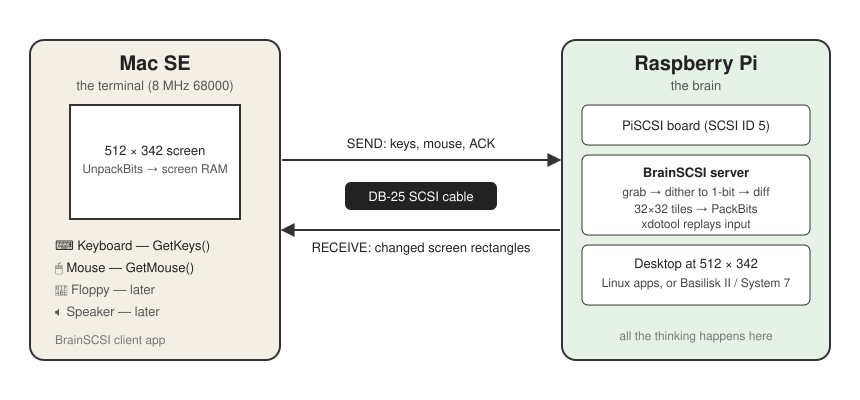
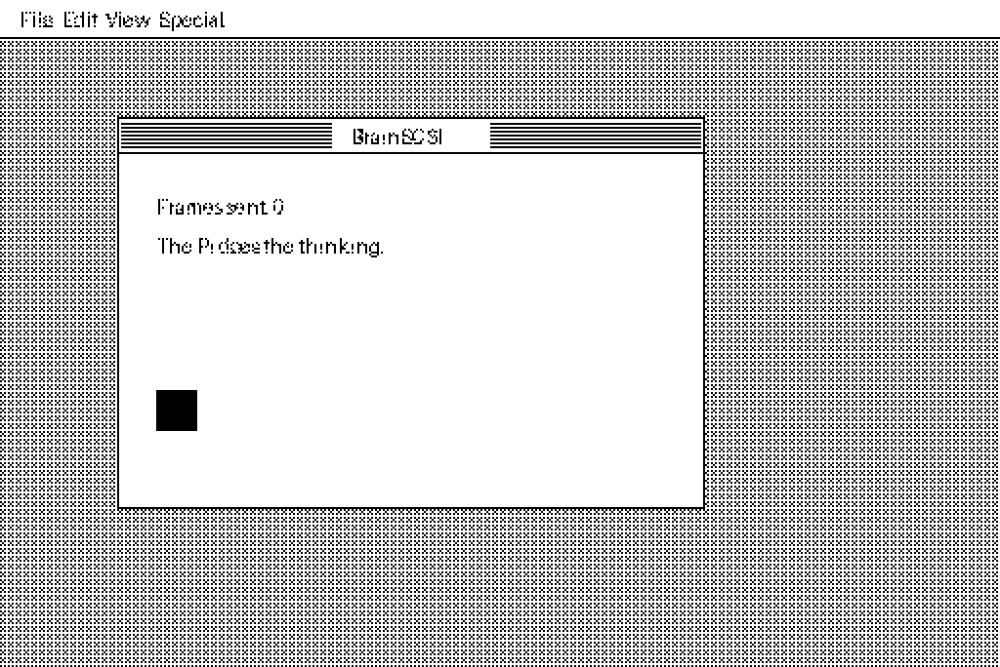

# 🧠 BrainSCSI

**Plug a Raspberry Pi into a Mac SE's SCSI port and let the Pi do all the thinking.**

The Mac SE becomes a terminal: its screen, keyboard and mouse stay exactly as they are, but everything you see is drawn by a Raspberry Pi on the end of the SCSI cable. No case opening, no soldering on the Mac, no changes to the SE. Unplug the Pi and it's a stock SE again.

> **Status:** prototype. The Pi-side screen server and the link protocol work and are tested end to end in a simulator. The Mac client is written and passes a syntax check. The PiSCSI device that joins them over a real SCSI cable is the next milestone.

<p align="center">
  
</p>

---

## How it works

1. A **PiSCSI** board on the Pi's GPIO header makes the Pi show up on the SE's SCSI bus as a device called `BRAIN`.
2. The Pi runs a desktop at the SE's own resolution, **512 × 342**. That can be Linux apps, or **Basilisk II running System 7** — a classic Mac that's about 20× faster than the SE it's shown on.
3. The **BrainSCSI server** on the Pi grabs the screen, turns it into 1-bit black and white, works out which 32 × 32 tiles changed, and compresses them with **PackBits**.
4. The **BrainSCSI app** on the SE asks the Pi for changes many times a second and drops them straight into screen memory using the Mac's own ROM routine, `UnpackBits`.
5. Every key and mouse move on the SE goes back to the Pi and is replayed on its desktop.

The 8 MHz 68000 never dithers, scales or decodes anything hard. The Pi does all of that and hands over data the Mac can copy straight to the screen.

## What it looks like

This is the simulator: the full pipeline running with a Python model of the SE's screen applying every packet, exactly as the real Mac app does.

<p align="center">
  
</p>

## Is it fast enough?

| | |
|---|---|
| Full SE screen, 1-bit | 21,888 bytes raw |
| Typical desktop screen after PackBits | about **3 KB** |
| SE SCSI speed (NCR 5380) | roughly 500 KB–1 MB/s |
| Typing a letter | one or two tiles, a few hundred bytes |
| Simulator estimate for a full redraw on a real SE | **about 60–90 ms** |
| Simulator estimate for small updates | **a few ms each** |

The simulator's numbers use cautious SE figures. Real hardware will tell us for sure, but the link has plenty of room: the 68000 copying bytes is the real limit, not the cable.

## What's in this repo

| Folder | What it is |
|---|---|
| [`docs/PROTOCOL.md`](docs/PROTOCOL.md) | The link protocol: SCSI commands, packet layout, every record type |
| [`pi/`](pi/) | The Pi side in Python: dithering, tile diffing, PackBits, packets, the server, input replay, and a simulator |
| [`mac/`](mac/) | The Mac SE app in C for the [Retro68](https://github.com/autc04/Retro68) cross-compiler |

## Try the Pi side now (any computer)

```sh
cd pi
pip install -r requirements.txt
python3 sim_mac.py --gif demo.gif                      # animated demo desktop
python3 sim_mac.py --image photo.jpg --dither atkinson  # see a photo the SE way
python3 -m unittest discover -s tests                   # 14 tests
```

### On the Pi with a live desktop

```sh
sudo apt install xvfb xdotool
Xvfb :1 -screen 0 512x342x24 &
DISPLAY=:1 your-favourite-app &      # or Basilisk II, a window manager, etc.
python3 -m brainscsi.server --source x --display :1 --listen tcp:127.0.0.1:5150
python3 sim_mac.py --connect tcp:127.0.0.1:5150      # watch it as the SE would
```

## Dithering

| Mode | Best for | Why |
|---|---|---|
| `ordered` (default) | Live desktops | Each pixel only depends on itself, so a change in one place never ripples elsewhere. Updates stay tiny. |
| `atkinson` | Photos, slideshows | Bill Atkinson's algorithm from MacPaint and HyperCard. Looks gorgeous, but changes can spread across the screen. |
| `threshold` | Text-only terminals | Pure black and white, sharpest text. |

## Parts list

| Part | Notes |
|---|---|
| Mac SE (or Plus, Classic, SE/30, Classic II) | Any 68k Mac with a SCSI port and 512 × 342 screen |
| Raspberry Pi 4 or Pi Zero 2 W | Pi 4 for running Basilisk II smoothly; Zero 2 W fits inside a small box |
| PiSCSI board | Open-source SCSI adapter for the Pi's GPIO header |
| DB-25 to 50-pin SCSI cable, or a DB-25 PiSCSI | Depends on which PiSCSI board you get |
| Terminator | PiSCSI has built-in termination; turn it on if the Pi is the last device |

## Roadmap

- [x] Link protocol v1
- [x] Pi screen server: grab, dither, tile diff, PackBits, packets
- [x] Input replay with Mac key codes (Command → Ctrl, Option → Alt)
- [x] Simulator and tests
- [x] Mac SE client (keyboard, mouse, screen)
- [ ] **PiSCSI device plugin** — a processor-type device that forwards SEND/RECEIVE to the server's socket
- [ ] First light on a real SE
- [ ] Sound: stream 8-bit mono to the SE's speaker
- [ ] Floppy: read SE floppies from the Pi and mount them as disk images
- [ ] Basilisk II preset: System 7.5 at 512 × 342, ready to go
- [ ] Mac cursor follows the Pi's cursor shape

## Other ways to do it

- **VNC over emulated Ethernet** — PiSCSI can already pretend to be a DaynaPORT network card, so an old Mac VNC client works with no new code. It's slow, because TCP/IP is heavy work for a 68000.
- **Drive the CRT directly** — feed the SE's analog board from the Pi's GPIO for full frame rate. Much faster, but it means working inside the case near high voltage, and the SE stops being a working Mac.

BrainSCSI takes the middle road: no case opening, and much faster than VNC.
